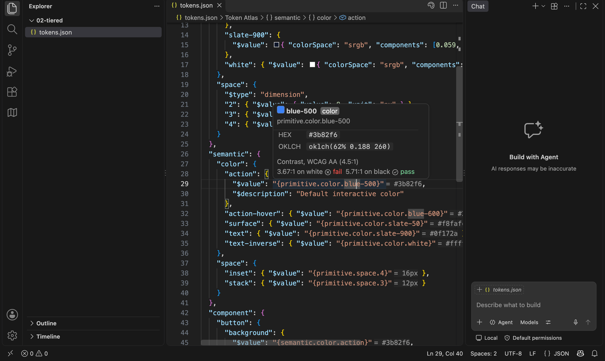
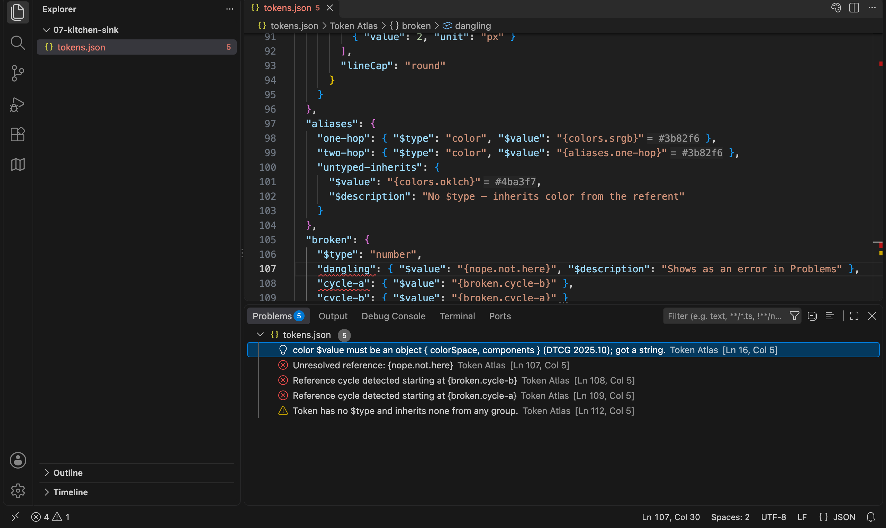
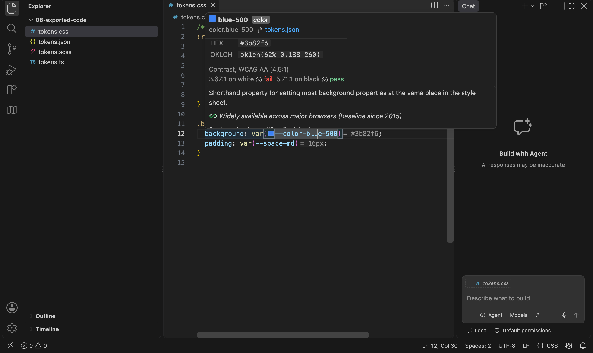
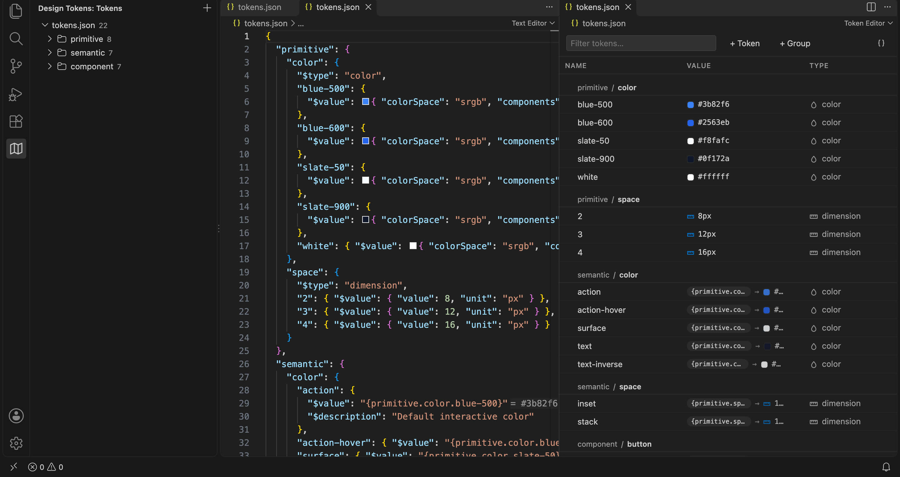
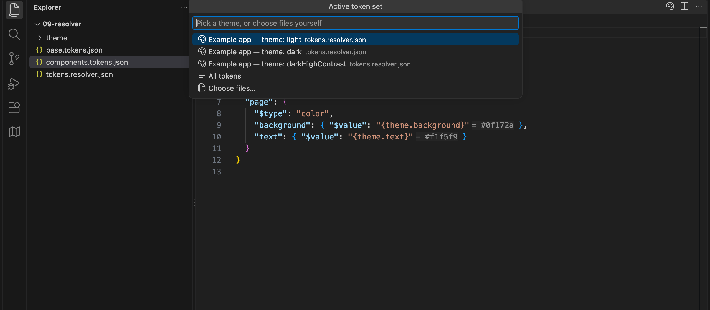

# Token Atlas

Design tokens in VS Code. Open a [W3C/DTCG token file](https://www.designtokens.org/tr/2025.10/format/) and it behaves like code: completion, hover, go-to-definition, find references, rename, color swatches, and validation. The same features work on the CSS, Sass, and JS your export tool writes, so `var(--color-brand-primary)` resolves back to the token it came from. A visual table editor is one click away for when you want to scan or bulk-edit. Your tokens stay in git as plain JSON with one-line diffs. There is no Figma sync to set up and nothing to subscribe to.



## Install

Search for **Token Atlas** in the Extensions view and click Install. Or press Cmd+P (Ctrl+P) and run `ext install chrisgriffinio.token-atlas`, or from a terminal:

```
code --install-extension chrisgriffinio.token-atlas
```

Needs VS Code 1.90 or newer.

Every [release](https://github.com/chrisgriffin/token-atlas/releases) also carries the `.vsix`, for an editor without Marketplace access. Install it with `code --install-extension token-atlas-<version>.vsix --force`, then reload the window.

## Getting started

1. Open a folder that contains token JSON. Any file with `$value` or `$type` in it counts as a token file, and so does any `.tokens` or `.tokens.json` file. You do not need to configure anything.
2. Hover a token or a `{reference}` to see what it resolves to. Cmd+click a reference to jump to its definition.
3. Start typing `{` inside a `$value` to get completion for every token path in the workspace.
4. Right-click a token file and choose _Reopen Editor With… → Token Editor_ to see the same file as a table.

Want something to poke at first? Clone this repo and open [`examples/`](examples/). Each folder is a different token architecture, from one flat file to multi-brand and resolver setups, with a note on what to try.

## What you get

### In token files

- Completion for `{alias}` references, `$type`, and `colorSpace`.
- Hover cards with the resolved value, the alias chain, hex and OKLCH for colors, and px, rem, and pt for dimensions.
- Inlay hints next to every reference: `{primitive.color.blue-500} = #3b82f6`.
- Color swatches inline, and a checkerboard behind translucent colors in hovers.
- Go to definition and find references across every token file in the workspace.
- Outline view, plus _Go to Symbol in Workspace_ (Cmd+T) by token path.
- Problems for unresolved references, reference cycles, bad values, and tokens that inherit no `$type`.
- Deprecated tokens are struck through everywhere they are used.
- Deprecate a token with a reason and a replacement (_Token Atlas: Deprecate Token…_, or the visual editor's Deprecated field), then move each use with a quick fix, list what still uses it, and get the remaining count before _Remove Deprecated Token_ deletes it. The replacement is written into `$deprecated` itself: `"use {color.border.default} instead"`.
- A quick fix that converts old-style string values like `"16px"` to the 2025.10 object form.



### In your code

Token Atlas knows that `--color-brand-primary`, `$color-brand-primary`, `colorBrandPrimary`, and `tokens.color.brand.primary` are all the same token, including when the export adds a prefix like `--ds-`. There is nothing to configure. In CSS, Sass, Less, JS, and TS:

- Hover or go to definition on an exported name to reach the token.
- Find references on a token to see where your code uses it.
- Swatches on color values and `var(--token) = #3b82f6` hints.
- Completion when you type `--`, `$`, or `@`, keeping whatever prefix the file already uses.
- Rename (F2) a token and every alias and code usage follows, as one undo step.



### The visual editor

Right-click a token file and choose _Reopen Editor With… → Token Editor_. It is a table over the same JSON: grouped by path, swatches on colors, aliases shown with what they resolve to. Open it beside the text editor and the two stay in sync. Every edit you make in the table lands as a one-line change in the file, so diffs stay readable.

The _Design Tokens_ view in the activity bar lists every token file in the workspace, with its groups. The **+** button creates a new file.



### Themes and brands

When the same token path lives in several files (a light and a dark theme, two brands, web and iOS), the status bar shows which set is active. Click it to switch, and every hover and hint re-resolves.

- A [DTCG resolver](https://www.designtokens.org/tr/2025.10/resolver/) file (`*.resolver.json`) adds each of its resolutions to the picker, such as _theme: dark_. Sources can be whole files, fragments like `theme.tokens.json#/dark`, or inline tokens. The resolver file is validated too.
- Tokens Studio `$themes` show up in the same picker.

The active set is remembered per workspace and never written to the repo.



## Commands

Six commands in the Command Palette; the last three also sit in a token file's right-click menu and act on the token under the cursor:

| Command                                                | What it does                                                                         |
| ------------------------------------------------------ | ------------------------------------------------------------------------------------ |
| `Token Atlas: New Token File`                          | Asks for a name and creates an empty `<name>.tokens.json`.                           |
| `Token Atlas: Open Current File in Token Editor`       | Opens the active token file as a table.                                              |
| `Token Atlas: Choose Active Token Files`               | The same picker the status bar opens.                                                |
| `Token Atlas: Deprecate Token…`                        | Asks for a reason and a replacement, and writes them into the token's `$deprecated`. |
| `Token Atlas: Find Remaining Uses of Deprecated Token` | Lists every use left across the workspace, opened files or not.                      |
| `Token Atlas: Remove Deprecated Token`                 | Deletes it, first saying how many uses remain if any do.                             |

In the _Design Tokens_ view, clicking a group opens the table scoped to that group, and clicking a token reveals it: in the table's detail panel if the table is open, otherwise at its line in the JSON.

## Settings

Everything lives under `tokenAtlas.*`. The defaults work for most repos.

| Setting                           | Default                                                                                                                                                                                                 | Does                                                                                          |
| --------------------------------- | ------------------------------------------------------------------------------------------------------------------------------------------------------------------------------------------------------- | --------------------------------------------------------------------------------------------- |
| `tokenAtlas.include`              | `["**/*.json", "**/*.tokens"]`                                                                                                                                                                          | Files scanned for tokens. Narrow in a huge repo.                                              |
| `tokenAtlas.exclude`              | `["**/node_modules/**", "**/.git/**", "**/dist/**", "**/build/**", "**/out/**", "**/coverage/**", "**/.next/**", "**/.vscode-test/**", "**/package.json", "**/package-lock.json", "**/tsconfig*.json"]` | Files left out of discovery. Replaces the list. JSON over 2 MB never scanned.                 |
| `tokenAtlas.defaultEditor`        | `"text"`                                                                                                                                                                                                | `text` or `visual`                                                                            |
| `tokenAtlas.rootFontSize`         | `16`                                                                                                                                                                                                    | For `px` ↔ `rem` in hovers                                                                    |
| `tokenAtlas.contrastTarget`       | `"AA"`                                                                                                                                                                                                  | WCAG level in color hovers: `AA`, `AA-large`, `AAA`, `AAA-large`, `non-text`                  |
| `tokenAtlas.defaultColorSpace`    | `"srgb"`                                                                                                                                                                                                | Color space for new color tokens                                                              |
| `tokenAtlas.defaultDimensionUnit` | `"px"`                                                                                                                                                                                                  | `px` or `rem` for new dimension tokens                                                        |
| `tokenAtlas.modeView`             | `"single"`                                                                                                                                                                                              | Mode files in the visual editor: `single` or `sideBySide`                                     |
| `tokenAtlas.validation`           | `"on"`                                                                                                                                                                                                  | DTCG problems and deprecation strikethrough: `on` or `off`                                    |
| `tokenAtlas.pathCollisions`       | `"information"`                                                                                                                                                                                         | A path defined in two files: `information`, `warning`, `off`                                  |
| `tokenAtlas.hardcodedValues`      | `"off"`                                                                                                                                                                                                 | A literal in CSS/Sass/Less that equals a token: `off`, `hint`, `warning`. Quick fix swaps it. |
| `tokenAtlas.unusedTokens`         | `"off"`                                                                                                                                                                                                 | Tokens nothing uses: `off`, `hint`, `information`. Scans every code file.                     |
| `tokenAtlas.codeColorSwatches`    | `true`                                                                                                                                                                                                  | Swatches on color tokens in code                                                              |
| `tokenAtlas.inlayHints`           | `true`                                                                                                                                                                                                  | `= value` hints on references and `var(--token)`                                              |

The defaults come from `package.json`, and a test fails if this table drifts from it.

Two settings are off by default because they scan every code file in the workspace: `tokenAtlas.hardcodedValues` flags a literal `#3b82f6` in your CSS that matches a token and offers to swap it, and `tokenAtlas.unusedTokens` flags tokens nothing references. Turn them on when you want a cleanup pass.

## Lint

Token Atlas can check your own naming and tiering conventions. Put a `token-atlas.lint.json` at the workspace root; without one, nothing runs. The file has schema completion.

```json
{
  "tiers": ["base", "system", "component"],
  "vocabularies": [{ "paths": ["system.radius"], "values": ["none", "sm", "md", "lg"] }],
  "rampPaths": ["base.color.*"],
  "naming": { "case": "kebab-case" },
  "contrastPairs": [{ "foreground": "system.color.text", "background": "system.color.surface" }],
  "rules": { "token-atlas/tier-alias-inverted": "error" }
}
```

| Rule                                | Flags                                                |
| ----------------------------------- | ---------------------------------------------------- |
| `token-atlas/tier-alias-inverted`   | An alias pointing up a tier                          |
| `token-atlas/vocabulary-invalid`    | A name outside the allowed set for its path          |
| `token-atlas/ramp-not-monotonic`    | A color ramp step whose lightness runs the wrong way |
| `token-atlas/name-case`             | A name not in the configured case                    |
| `token-atlas/contrast-insufficient` | A foreground/background pair below its WCAG target   |

Each rule is `"off"`, `"warn"` (the default), or `"error"`. Findings show up in Problems on save.

## DTCG support

Token Atlas targets the Design Tokens Format Module **2025.10**, the first stable release: groups, `$type` inheritance, `{alias}` and `$ref` references, `$extends`, validation of every value type, and color math through [colorjs.io](https://colorjs.io). Color values are objects (`{ "colorSpace": "srgb", "components": [0.231, 0.51, 0.965] }`) and dimensions are `{ "value": 16, "unit": "px" }`. The quick fix in the editor upgrades older string values for you.

## Contributing

How the code is laid out: [docs/architecture.md](docs/architecture.md). Press F5 to run the extension against `examples/` in a development host.

## Author

Made by [Chris Griffin](https://chrisgriffin.io).

## License

MIT © 2026 Chris Griffin
